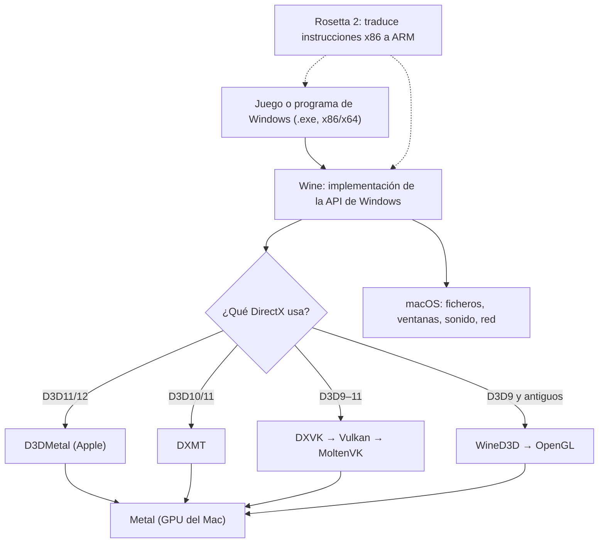
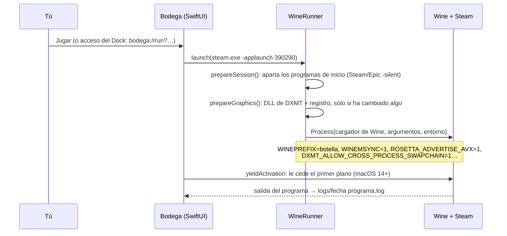

# Cómo funciona Bodega

Bodega abre programas y juegos de Windows en un Mac con Apple Silicon. No es un emulador ni una máquina virtual: no hay ningún Windows instalado. El programa de Windows corre como un proceso normal de macOS, y cada vez que llama a Windows (abrir un fichero, crear una ventana, dibujar con DirectX), esa llamada se traduce a su equivalente en macOS.

Este documento explica las piezas, de abajo arriba.

## 1. Las capas



| Capa | Qué hace |
|---|---|
| **Rosetta 2** | El juego está compilado para procesadores Intel (x86). Rosetta traduce sus instrucciones a ARM (Apple Silicon) mientras se ejecuta. Wine también es x86_64, así que juego y Wine corren dentro del mismo proceso traducido. |
| **Wine** | Reimplementa las DLL de Windows (`kernel32`, `user32`, `ntdll`…) sobre macOS. Cuando el juego llama a `CreateFileW`, Wine abre el fichero con las llamadas de macOS. |
| **Traductores gráficos** | Convierten Direct3D (la API gráfica de Windows) a Metal (la de Apple). Hay varios y cada uno sirve para unos juegos. |
| **Bodega** | La app que lo orquesta: crea las botellas, elige motor y traductor, lanza los programas y corrige lo que falla. |

## 2. Wine por dentro

Cada DLL de Wine tiene dos mitades:
- **Parte Windows** (formato PE): las ve el juego como si fueran las DLL de Windows. Están en `lib/wine/x86_64-windows` (64 bits) y `lib/wine/i386-windows` (32 bits).
- **Parte Unix** (`.so`, en `lib/wine/x86_64-unix`): habla con macOS. `winemac.so` crea las ventanas con Cocoa y `winecoreaudio.so` saca el sonido.

Las dos mitades se comunican mediante *unix calls*. Los juegos de **32 bits** funcionan con **WoW64**: código de 32 bits dentro de un proceso de 64 bits, como en el Windows real.

Además existe el **`wineserver`**: un proceso por botella que hace de «núcleo» de Windows. Lleva los procesos, los *handles*, el registro y la sincronización entre hilos.

### Botellas

Una **botella** es un Windows aislado: una carpeta (un `WINEPREFIX`) con lo siguiente.

```
Juegos/
├── drive_c/             ← la unidad C: (Program Files, users, windows/system32…)
├── dosdevices/          ← c: → ../drive_c,  z: → /  (todo el Mac se ve como Z:)
├── system.reg, user.reg ← el registro de Windows, en texto
├── bodega.json          ← ajustes de Bodega: motor, traductor, Retina, programas anclados…
└── logs/                ← un registro por cada programa lanzado
```

Cada botella tiene su propio registro, sus programas y su versión de Windows. Lo que se rompe en una no afecta a las demás.

## 3. El motor: Motor Bodega

Bodega no necesita ningún programa comercial. Su motor es **Motor Bodega 26.3**, que se compila en el propio Mac con `engine/build-motor.sh`:

- **Wine 11.0 de CodeWeavers**: la versión de Wine que mantiene CodeWeavers, compilada desde el código fuente que publica bajo licencia LGPL. Trae mejoras propias para macOS, entre ellas **MSync**: la sincronización entre hilos (mutex, eventos) se resuelve con puertos Mach de macOS, en lugar de preguntar al `wineserver` cada vez. Eso da mucho rendimiento en juegos con muchos hilos.
- **Compilación cruzada**:
  - La parte Unix se compila con `clang -arch x86_64 -mmacosx-version-min=10.15`.
  - La parte Windows se compila con `mingw-w64`, en 64 y 32 bits.
  - Las bibliotecas x86_64 que necesita (freetype, gnutls, SDL2 para mandos, MoltenVK) salen del motor libre «Wine Staging 11.21».
- **Vídeo**: FFmpeg 7.1 (`winedmo`, para Media Foundation) y GStreamer (`winegstreamer`, para DirectShow y WMV), para las cinemáticas de los juegos.
- **.NET y web**: Wine Mono 10.4.1 y Wine Gecko.
- **Parche propio** (`engine/patches/0001-…`), ver el apartado 6.

El script descarga todo con sumas SHA-256 fijadas: si algo cambia, no compila.

## 4. Gráficos: cómo elige Bodega

| Traductor | Para qué | Cómo llega a la GPU |
|---|---|---|
| **DXMT** | Direct3D 10 y 11 | Directo a Metal |
| **DXVK** | Direct3D 9, 10 y 11 | Vulkan → MoltenVK → Metal |
| **D3DMetal** | Direct3D 11 y 12 | Metal. Es de Apple y viene en su Game Porting Toolkit |
| **WineD3D** | Todo, sobre todo D3D9 | OpenGL (que macOS implementa sobre Metal) |

El modo **Automático** usa D3DMetal si está instalado; si no, DXMT para D3D10/11 y WineD3D para D3D9. La DXVK que funciona en Mac (1.10) deja en negro muchos juegos D3D9: lo vimos con Bulb Boy.

**Cómo se activa un traductor** (`GraphicsResolver`):
1. Copia sus DLL (`d3d11.dll`, `dxgi.dll`…) a `system32` y `syswow64` de la botella. Les quita la marca interna «Wine builtin DLL», porque Wine se niega a cargar como nativa una DLL que lleve esa marca.
2. Escribe en el **registro** de la botella que esas DLL se cargan nativas (`native,builtin`).
3. Para ajustes por programa usa `AppDefaults\<programa>.exe\DllOverrides`, el mecanismo estándar de Wine. Así un juego concreto puede ir con otro traductor.

Ojo: la variable `WINEDLLOVERRIDES` tiene prioridad sobre `AppDefaults`, así que Bodega no la usa para los gráficos.

D3DMetal es de Apple y no se puede redistribuir. Es opcional: cada usuario se baja el Game Porting Toolkit de Apple (y decide si su licencia le permite este uso), y Bodega lo importa en un **clon APFS** del motor: una copia instantánea que no ocupa espacio extra.

## 5. Qué pasa al pulsar «Jugar»



Detalles que costó descubrir:
- **Rutas**: a los programas de Windows (`msiexec`, `cmd`) se les pasa siempre una ruta de Windows (`C:\…` o `Z:\…`). Con una ruta Unix, `msiexec` se colgaba al instalar Epic.
- **Primer plano**: desde macOS 14 una app no pasa al frente si la app activa no le cede el turno. Sin eso, el juego se veía pero no recibía clics.
- **Programas de inicio**: Steam y Epic se apuntan para abrirse solos con Windows. Bodega los aparta editando `user.reg` con la botella parada. No usa `reg delete`, porque arrancar Wine es justo lo que los ejecuta.
- **Procesos huérfanos**: los procesos de una botella se reconocen por los ficheros que tienen abiertos en `/tmp/.wine-<uid>/server-<dispositivo>-<inodo>`. «Cerrar todo» cierra también los que han perdido su `wineserver`, como un lanzador que se queda colgado al 100 % de CPU.

## 6. El caso de la ventana negra de Steam

La interfaz de Steam es un Chromium (`steamwebhelper.exe`). Chromium dibuja la página en un proceso y la muestra en una ventana de **otro** proceso. En Wine 11 para macOS esos fotogramas nunca llegan a la ventana, así que la ventana sale negra. Es el mismo síntoma que el [fallo 56014 de Wine](https://bugs.winehq.org/show_bug.cgi?id=56014) (descrito en Linux con Wayland). En Mac lo documentan proyectos como [bridgewine](https://github.com/NNikolaG/bridgewine/pull/12) y [Highball](https://github.com/gauthierpiarrette/highball/issues/282).

Bodega lo arregla con un **parche propio** en `kernelbase` (`CreateProcessInternalW`):
- Cuando Windows va a lanzar el `steamwebhelper.exe` principal, le añade `--disable-gpu --single-process`. Así Chromium dibuja y muestra en el mismo proceso.
- No toca ningún fichero de Steam.
- Se desactiva con `BODEGA_STEAMWEBHELPER_ARGS=""`.

Se llegó a esta causa comparando trazas de carga de DLL y probando distintos motores de Wine.

## 7. El código

```
Sources/BodegaCore   (2.406 líneas) — todo lo que no es interfaz
  WineEngine, EngineLocator     motores y su detección (Motor Bodega primero)
  EngineInstaller               descarga verificada del motor libre
  D3DMetalInstaller             importa D3DMetal del GPTK en un clon APFS del motor
  Bottle, BottleStore           botellas, bodega.json, exportar/importar .tar.gz
  WineRunner                    entorno, lanzamiento, registro, Retina, «Cerrar todo»
  Graphics, Compatibility       plan gráfico, DLL nativas y reglas por ejecutable
  StartupItems, BottleProcesses programas de inicio y procesos huérfanos
  SteamLibrary, GameStore       biblioteca de Steam (manifiestos .acf, carátulas) y tiendas
  ProgramIcons                  iconos leídos del formato PE y destinos de .lnk (sin ejecutar nada)
  MacShortcuts                  apps para el Dock/Launchpad que abren bodega://run?…
  WindowsDependency             Visual C++ y DirectX con los instaladores de Microsoft
Sources/BodegaApp    (1.599 líneas) — SwiftUI: barra lateral, detalle de botella, ajustes, motores
Sources/bodegactl    (287 líneas)   — la misma funcionalidad por terminal
Tests/               31 tests de Swift Testing (scripts/test.sh)
engine/              build-motor.sh y patches/
```

Swift 6 (concurrencia estricta) y SwiftUI para macOS 14+. Se compila solo con las Command Line Tools, sin Xcode: `scripts/build-app.sh` empaqueta la `.app`.

## 8. Límites

- **Rendimiento**: usa los traductores habituales en Mac (DXMT, DXVK y, si lo añades, D3DMetal), y llama a Wine directamente, sin capas intermedias. Aún no se ha medido con un juego exigente.
- **DirectX 12** necesita D3DMetal: hay que bajar el Game Porting Toolkit de Apple, gratis con una cuenta de desarrollador.
- **Compatibilidad**: Bodega tiene el mecanismo de ajustes por juego (reglas por ejecutable), pero aún no trae reglas de serie: se crean a medida que aparecen problemas.
- **Legal**: es código propio bajo [licencia MIT](../LICENSE), sin garantías. Wine, DXMT, DXVK, MoltenVK, FFmpeg y GStreamer se usan según sus licencias libres, y D3DMetal según la de Apple.
